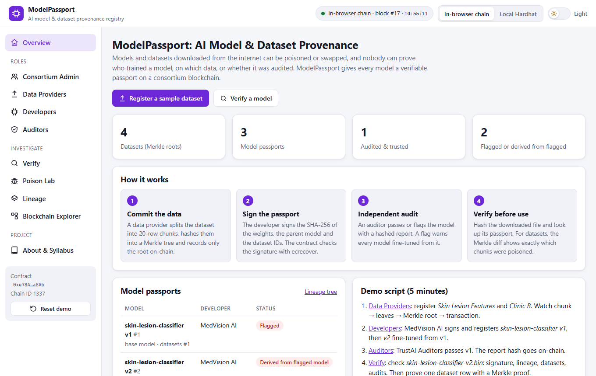
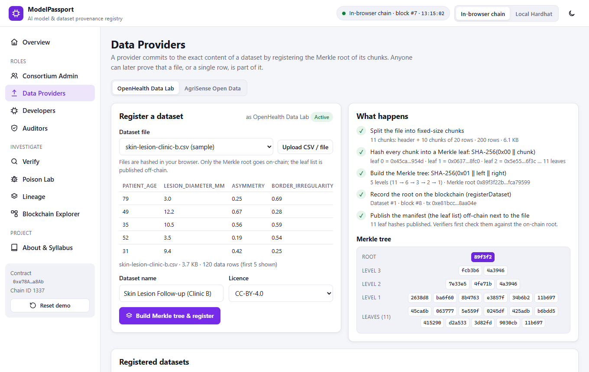
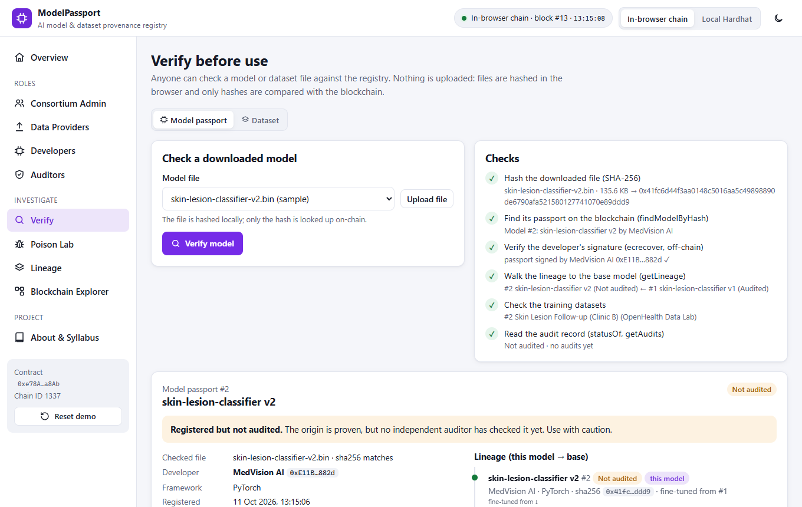
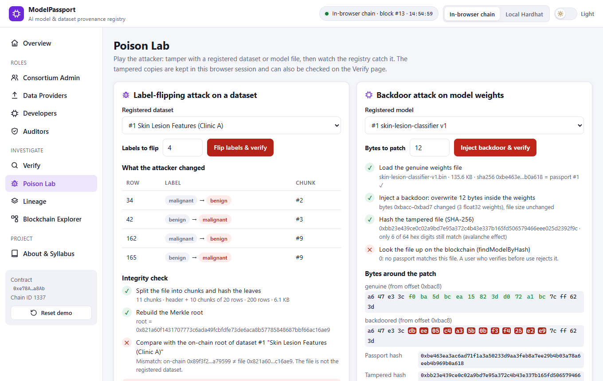
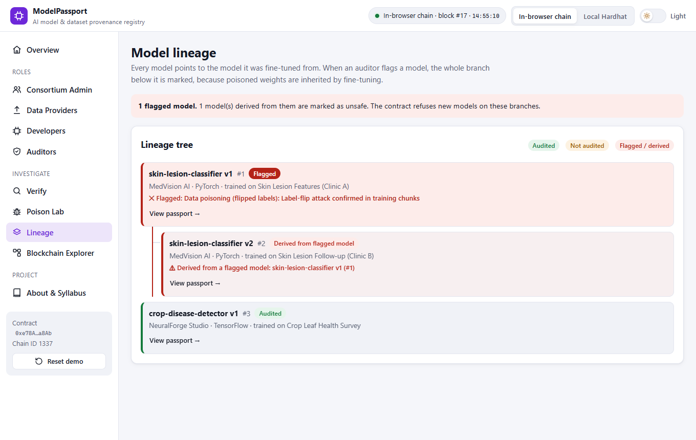
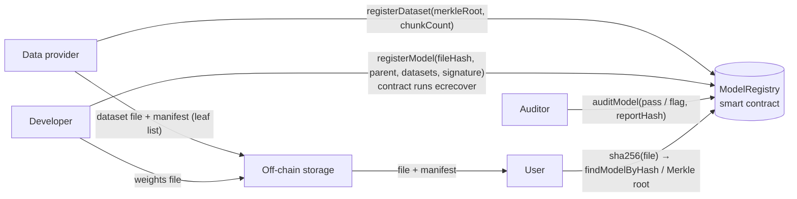

# ModelPassport: AI Model & Dataset Provenance Registry

A consortium blockchain that gives every AI model a **passport**: which datasets it was trained on (as Merkle roots), which model it was fine-tuned from, who built it (an ECDSA signature checked on-chain) and what independent auditors found.

**Live demo:** https://syedareeb06.github.io/ai-model-provenance-registry/ (runs entirely in your browser: no wallet, no install, no real cryptocurrency)



---

## The problem

Teams download pre-trained models and public datasets every day. Today:

- a file can be swapped or **poisoned** on the way (a few flipped labels in a dataset, a few changed bytes in the weights that act as a backdoor),
- nobody can prove **who trained a model, on which data, and what it was fine-tuned from**, and
- when a model turns out to be unsafe, the models **derived from it** keep being used because nothing links them.

## The solution

| Step | What happens | Technique |
|---|---|---|
| 1. Commit the data | A data provider splits the dataset into chunks (20 CSV rows each), hashes every chunk into a Merkle leaf and records only the **Merkle root** on-chain. The leaf list (manifest) is published off-chain. | SHA-256, Merkle tree |
| 2. Sign the passport | The developer hashes the weights file and signs `fileHash + parent model + dataset IDs`. The **contract recovers the signer with `ecrecover`** and rejects the passport unless it is the sender. | ECDSA (secp256k1), EIP-191 |
| 3. Independent audit | An auditor records **pass** (valid 180 days) or **flag** with the SHA-256 of the report. A flag **taints every descendant**, and the contract refuses new models on that branch. | Smart contract rules |
| 4. Verify before use | Anyone hashes a downloaded file and looks up its passport. For a dataset, the Merkle diff names **exactly which chunks changed**, and a Merkle proof shows that one row belongs to it. | Hash lookup, Merkle proof |

## Features

- **Consortium Admin**: admit data providers, developers and auditors (one role each); suspend or re-activate members
- **Data Providers**: register a dataset with live steps (chunk → leaves → Merkle root → transaction → manifest) and a drawing of the Merkle tree
- **Developers**: register a model with lineage and datasets; the passport is signed (r, s, v shown) and verified on-chain; revoke a model
- **Auditors**: re-check the file, signature, dataset manifests and lineage; hash the report; pass or flag; jump 181 days to see audits expire
- **Verify**: model passport (owner, version, signature check, lineage chain with statuses, datasets, audits) and dataset check (Merkle root, per-chunk diff, single-row Merkle proof checked in the browser **and** by the contract's `verifyChunk()`)
- **Poison Lab**: flip labels in a registered dataset or patch bytes in a model, then watch the registry catch it
- **Lineage**: tree of all models; flagged models and everything derived from them are highlighted
- **Blockchain Explorer**: hash-linked blocks, decoded transactions and the full audit log
- Built-in sample data generated in the browser (4 CSV datasets, 5 synthetic weight files); you can also upload your own files up to 10 MB (only hashes and leaf lists are stored)
- Two blockchains: an **in-browser Ethereum chain** (zero setup) or a **local Hardhat node**
- **Light / dark theme switch** in the top bar (follows your system theme until you choose, then remembers it)

| Data provider registers a dataset | Model passport check |
|---|---|
|  |  |

| Poison Lab | Lineage with a flagged branch |
|---|---|
|  |  |

## Syllabus mapping (22CS743, Blockchain Technology)

| Module | Concepts | Where they appear in this project |
|---|---|---|
| **II** | SHA-256, Merkle trees and Merkle proofs, hash-linked blocks | SHA-256 of weights files and dataset chunks; one Merkle root per dataset; per-chunk diff; single-row Merkle proofs verified in the browser and on-chain (`verifyChunk`); explorer checks each block's previous-hash link |
| **III** | Ethereum, EVM, smart contracts, digital signatures | `ModelRegistry.sol` holds passports, lineage and audits; developers sign with secp256k1 keys (EIP-191) and the contract recovers the signer with `ecrecover`, rejecting malleable (high-s) and malformed signatures |
| **IV** | Consortium / permissioned blockchain | The AI Safety Consortium (admin) admits data providers, developers and auditors with roles and can suspend them; every function checks the caller's role |
| **V** | Security and applications: AI supply chain | Detects dataset poisoning (label flipping) and model tampering (backdoors); audit trail with expiry; revocation; taint propagation through the lineage; only hashes go on-chain |

## Architecture



**On-chain:** members and roles, dataset Merkle roots, chunk counts and sizes, model weights hashes, parent links, dataset links, developer signatures, audit verdicts with report hashes, revocations.
**Off-chain:** the dataset and model files, dataset manifests and full audit reports. Their hashes on-chain make them tamper-evident.

### Design notes

- **Chunking:** CSV/TSV/TXT files: the header line is chunk 0, then 20 data rows per chunk (more rows per chunk if a file would need over 256 chunks). Other files: equal byte blocks of at least 4 KiB. The rule depends only on the file, so anyone can re-chunk a download.
- **Merkle tree:** leaf = `SHA-256(0x00 ‖ chunk)`, node = `SHA-256(0x01 ‖ left ‖ right)`, index-based pairs (not sorted), an unpaired last node moves up unchanged. The prefixes keep leaves and inner nodes apart. The contract's `verifyChunk()` uses the same rules.
- **Manifest first:** before locating changed chunks, the verifier rebuilds the root from the published leaf list and compares it with the on-chain root, so a forged manifest is caught.
- **Passport message:** `keccak256("ModelPassport" ‖ chainId ‖ registry ‖ fileHash ‖ parentId ‖ keccak256(datasetIds))`, signed as an EIP-191 personal message. Including the chain id and contract address prevents replay on another chain or registry.

## Tech stack

- **Smart contract:** Solidity 0.8.24, Hardhat (local blockchain, 22 tests, deployment)
- **Frontend:** HTML, CSS, JavaScript (no build step), ethers.js v6, Web Crypto API (SHA-256)
- **Demo blockchain:** Ganache running inside the browser (same EVM, same contract)
- **Hosting:** GitHub Pages

## Project structure

```
ai-model-provenance-registry/
├── blockchain/                         # Smart contract project (Hardhat)
│   ├── contracts/ModelRegistry.sol
│   ├── test/ModelRegistry.test.js      # 22 unit tests
│   ├── scripts/deploy.js               # deploy + register demo consortium on localhost
│   ├── scripts/export-artifact.js      # copy ABI + bytecode into the web app
│   └── hardhat.config.js
├── frontend/                           # Web app (open index.html)
│   ├── index.html
│   ├── css/
│   ├── js/app.js                       # ModelPassport screens and logic
│   ├── js/modelpassport-crypto.js      # chunking, Merkle tree/proofs, passport message, samples, attacks
│   ├── js/chain.js                     # in-browser chain / local Hardhat connection
│   ├── js/contract-artifact.js         # compiled contract (generated)
│   └── vendor/                         # ethers.js, Ganache (browser builds)
├── docs/screenshots/
└── index.html                          # redirects GitHub Pages to frontend/
```

## How to run

### Option 1: Zero install (recommended for demos)

Open the [live demo](https://syedareeb06.github.io/ai-model-provenance-registry/), **or** double-click `frontend/index.html`.
An Ethereum blockchain starts inside the page with the consortium already registered. Your data is saved in the browser; click **Reset demo** in the sidebar to start over.

### Option 2: Local Hardhat blockchain

Requires [Node.js](https://nodejs.org/) 18 or newer.

```bash
cd blockchain
npm install
npm run node
```

Keep that terminal open. In a second terminal:

```bash
cd blockchain
npm run deploy
```

Then open `frontend/index.html` and click **Local Hardhat** in the top bar. (If you skip `npm run deploy`, the app deploys the contract itself.)

### Run the smart contract tests

```bash
cd blockchain
npm test
```

### After changing the contract

```bash
cd blockchain
npm run export
```

This recompiles and copies the new ABI and bytecode into `frontend/js/contract-artifact.js`.

## 5-minute demo script

1. **Data Providers** (OpenHealth Data Lab) → *Build Merkle tree & register* for *Skin Lesion Features*, then again for *Clinic B*. Watch chunk → leaves → root → transaction, and the tree drawing.
2. **Developers** (MedVision AI) → *Sign & register passport* for `skin-lesion-classifier-v1.bin`, then for `v2` (fine-tuned from v1, pre-filled).
3. **Auditors** (TrustAI Auditors) → pass v1. The report hash goes on-chain.
4. **Verify** → *Verify model* on `skin-lesion-classifier-v2.bin`: signature, lineage v2 ← v1, datasets, audits. On the **Dataset** tab, verify the CSV and build a Merkle proof for row 57 (checked in the browser and by the contract).
5. **Poison Lab** → *Flip labels & verify*: the diff names exactly the chunks holding the flipped rows. *Inject backdoor & verify*: 12 changed bytes, no passport matches.
6. **Auditors** → flag v1 as poisoned. **Lineage** now marks v2 as *derived from a flagged model*.
7. **Developers** → NeuralForge Studio tries to register `skin-lesion-mobile-v1.bin` on top of v2: **blocked by the smart contract**.
8. **Blockchain Explorer**: show the hash-linked blocks and the audit log.

## Publishing on GitHub Pages

1. Push this folder to a GitHub repository named `ai-model-provenance-registry`.
2. On GitHub: **Settings → Pages → Build and deployment → Source: Deploy from a branch → Branch: `main`, folder: `/ (root)` → Save**.
3. After about a minute the site is live at `https://syedareeb06.github.io/ai-model-provenance-registry/`.

## Limitations and future work

- A passport proves where a file came from and that it is unchanged. It does not prove the model is safe; that is the auditor's job, and the demo audit checks are simplified.
- The Merkle root only detects changes made **after** registration. Poisoning done by the data provider before registering is not detected; that needs data audits.
- In the demo the developers' keys live in the in-browser chain. Real developers would sign with a hardware wallet. Very large real model files would be hashed in a streaming way.
- A production deployment would run on a permissioned network such as Hyperledger Besu operated by the consortium.

## License

MIT, see [LICENSE](LICENSE).
